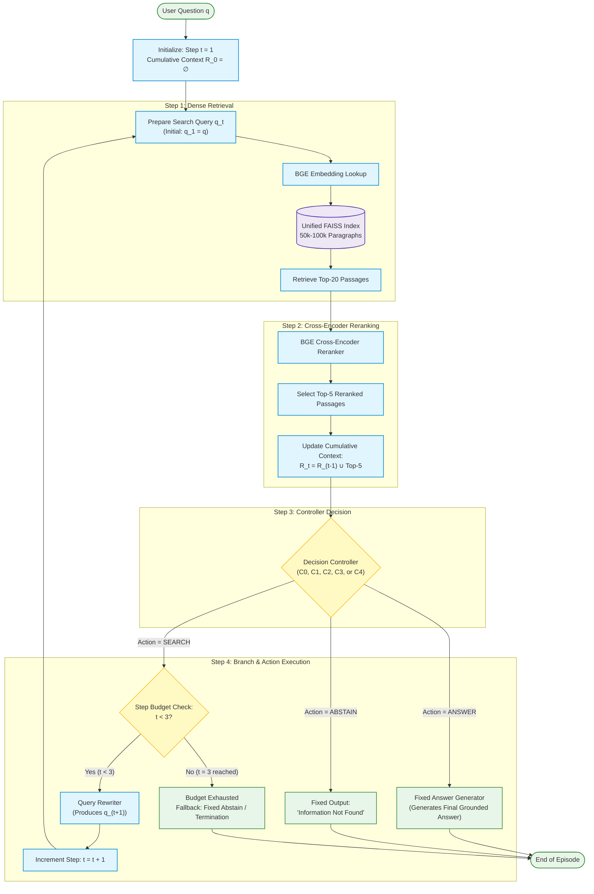
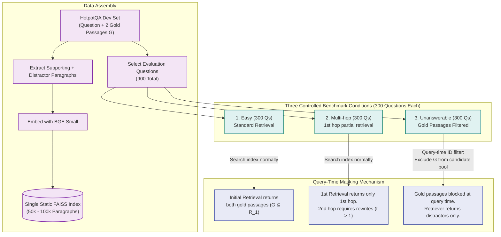
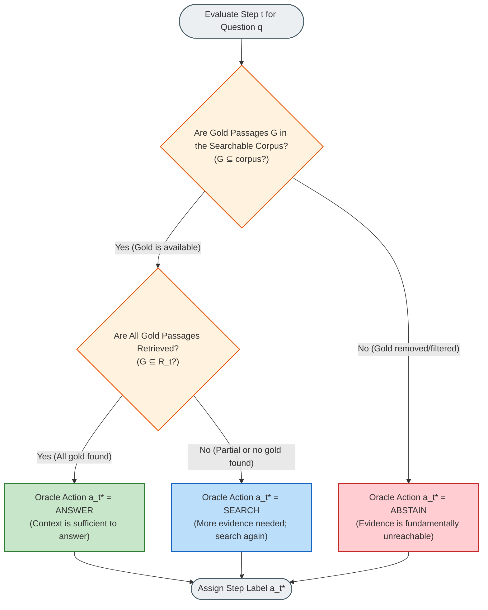
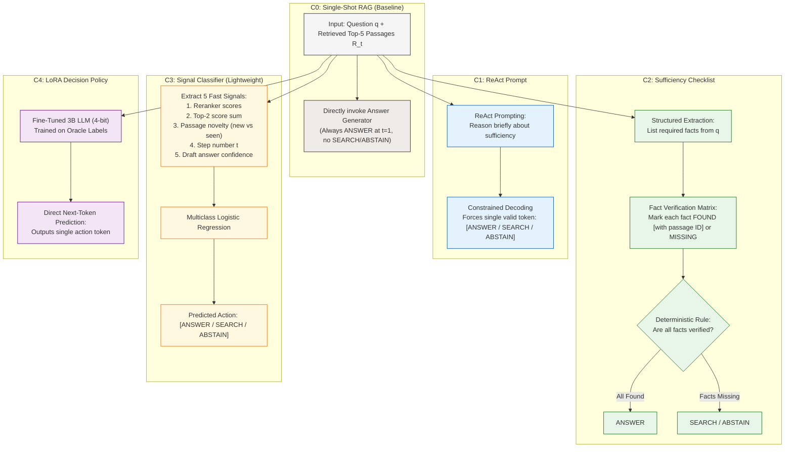
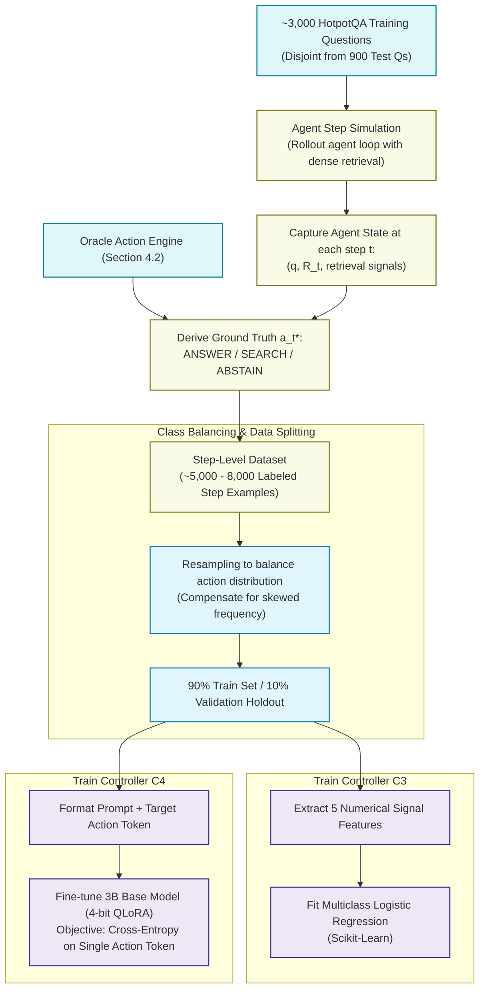

# Section 4 (Method) Analysis & Step-by-Step Workflow Diagrams

This document breaks down **Section 4: Method** of the research draft *"Answer, Search, or Abstain: Can RAG Agents Tell When Their Context Is Enough?"* into structured architectural diagrams and step-by-step technical workflows.

---

## 1. High-Level Overview of Section 4

Section 4 defines a controlled experimental methodology designed to isolate and evaluate how RAG agents make the critical decision of whether their retrieved context is sufficient. It is organized into four core pillars:

1. **Section 4.1 (Benchmark):** Construction of a 900-question testbed spanning three controlled conditions (Easy, Multi-hop, Unanswerable) with query-time corpus filtering.
2. **Section 4.2 (Oracle Labels):** A formal mathematical definition of the ground-truth optimal action at every agent step ($a_t^* \in \{\text{ANSWER}, \text{SEARCH}, \text{ABSTAIN}\}$).
3. **Section 4.3 (System):** The unified multi-step agent runtime loop (retrieve $\to$ rerank $\to$ controller $\to$ branch) with controlled fixed components.
4. **Section 4.4 (Controllers):** An ablation hierarchy of five decision controllers (C0–C4) ranging from naive single-shot to prompted reasoning, checklist verification, signal classification, and a LoRA policy adapter.

---

## 2. Step-by-Step Workflow Diagrams

### Diagram 1: The Agent Execution Loop (Section 4.3)
Visualizes the multi-step runtime loop ($t \in \{1, 2, 3\}$), showing how retrieved passages are processed and branched by the controller.

---

### Diagram 2: Benchmark Construction & Query-Time Filtering (Section 4.1)
Shows how 900 evaluation instances across three conditions are derived from HotpotQA using query-time filtering without rebuilding indices.

---

### Diagram 3: Step-Level Oracle Action Derivation Logic (Section 4.2)
Illustrates the exact decision rule that generates ground-truth supervision and evaluation labels at every step $t$.

---

### Diagram 4: Controller Architectures & Decision Pathways (Section 4.4)
Compares how each of the five controllers processes the cumulative retrieved passages $R_t$ to produce a decision.

---

### Diagram 5: Training Pipeline for Learned Controllers C3 & C4 (Section 4.4 & 5)
Visualizes the offline rollout and data preparation pipeline that trains C3 and C4 on oracle step labels without test data contamination.

---

## 3. Summary of Key Methodological Safeguards

| Component | Methodological Safeguard in Draft | Impact on Rigor |
| :--- | :--- | :--- |
| **Controlled Variates** | Retriever (`BGE-small`), reranker (`BGE-reranker`), and answer prompt are identical across all controllers. | Isolates controller decision performance from retriever quality. |
| **Query-Time Masking** | Evaluates unanswerable questions by filtering gold passages at retrieval time. | Keeps a single FAISS index without rebuilding for each condition. |
| **Exact Oracle** | Ground truth $a_t^*$ is mathematically grounded in gold passage set membership ($G \subseteq R_t$). | Eliminates subjective annotation; enables granular per-step confusion matrices. |
| **Data Hygiene** | 3k training questions and 900 dev test questions have strictly zero overlap. | Prevents memorization of HotpotQA entity pairs. |
| **Class Balancing** | Step-level dataset (5k–8k steps) is resampled across `ANSWER`, `SEARCH`, `ABSTAIN`. | Prevents trivial majority-class collapse towards `ANSWER`. |
